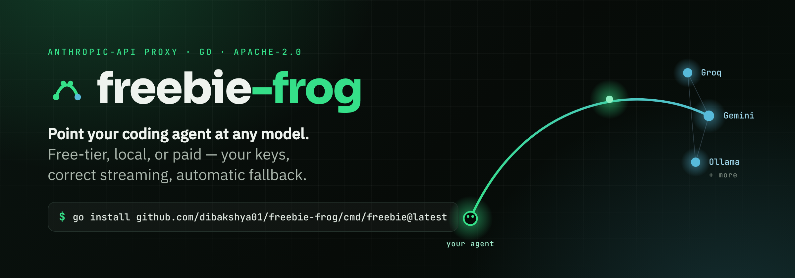
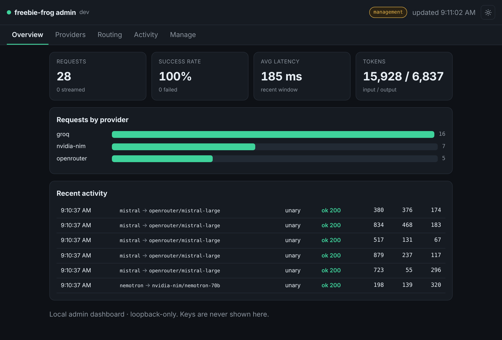

<div align="center">

<a href="https://dibakshya01.github.io/freebie-frog/">
  
</a>

<p>
A single-binary, security-first proxy that speaks the <strong>Anthropic Messages API</strong><br>
and routes it to free-tier, local, or paid providers — your keys, correct<br>
streaming, and automatic fallback.
</p>

<p>
<a href="https://github.com/dibakshya01/freebie-frog/actions/workflows/ci.yml"></a>
<a href="LICENSE"></a>
<a href="go.mod"></a>


<a href="CONTRIBUTING.md"></a>
</p>

<p>
<a href="https://dibakshya01.github.io/freebie-frog/"><b>Website</b></a> &nbsp;·&nbsp;
<a href="https://dibakshya01.github.io/freebie-frog/eli5.html">Explain simply</a> &nbsp;·&nbsp;
<a href="https://dibakshya01.github.io/freebie-frog/docs.html">Docs</a> &nbsp;·&nbsp;
<a href="https://dibakshya01.github.io/freebie-frog/architecture.html">Architecture</a> &nbsp;·&nbsp;
<a href="#admin-dashboard">Dashboard</a> &nbsp;·&nbsp;
<a href="#install">Install</a>
</p>

</div>

---

Your coding agent is wired to one wire protocol. The models you want to use speak
another. **freebie-frog sits in the middle** so you choose the model, not the vendor:
point the agent at it with `ANTHROPIC_BASE_URL`, and it receives Anthropic Messages
API requests, translates them to the target provider (OpenAI-compatible or Gemini),
calls the provider with your key, and translates the response — **including the full
streaming event sequence** — back into Anthropic format.

> **Independent open-source project. Not affiliated with or endorsed by** Anthropic,
> OpenAI, Google, or any model provider. "Claude Code", "Anthropic", "OpenAI",
> "Gemini", and other names are trademarks of their respective owners.

## Why freebie-frog?

<table>
<tr>
<td width="33%" valign="top">

### 🔀 Provider choice
One generic OpenAI-compatible adapter reaches **NVIDIA NIM, Groq, DeepSeek,
OpenRouter, Together, Mistral** and local servers (**Ollama, llama.cpp, vLLM, LM
Studio**) — plus a native **Gemini** adapter and an **Anthropic** passthrough.

</td>
<td width="33%" valign="top">

### 🛡️ Security-first
SSRF-guarded outbound calls (dial-time IP validation, defeats DNS rebinding),
OS-keychain / encrypted-file secret storage, loopback bind by default, and **no
secret logging**. Mapped to the OWASP LLM & API Top 10s.

</td>
<td width="33%" valign="top">

### 🤝 Honest by design
It uses **your** keys and respects each provider's terms — single-account, BYO-key,
**no quota evasion**. Token counts and feature parity are reported truthfully, not
oversold. Clean-room and trademark-clean.

</td>
</tr>
<tr>
<td width="33%" valign="top">

### 📡 Streaming done right
Rebuilds the Anthropic SSE sequence from provider chunks — including partial
tool-call arguments accumulated by index — and is covered by golden snapshot tests.

</td>
<td width="33%" valign="top">

### ♻️ Routing & fallback
Match a model by exact alias, then tier (`opus`/`sonnet`/`haiku`/`fable`), then a
default chain. Targets are tried in order, so a throttled free tier falls back
automatically.

</td>
<td width="33%" valign="top">

### 📊 Live dashboard
A built-in, loopback-only admin dashboard shows request volume, success rate,
latency, token usage and per-provider health — with an opt-in tab to edit config
from the browser.

</td>
</tr>
</table>

## Install

```sh
go install github.com/dibakshya01/freebie-frog/cmd/freebie@latest
# or, from a clone:
make build   # -> ./bin/freebie
```

Requires **Go 1.24+**. The result is a single static binary — no runtime to install.

### As a Claude Code plugin

Prefer to drive it from inside Claude Code? This repo ships a plugin with
`/freebie-frog:*` slash commands (setup, start, doctor, providers, use):

```text
/plugin marketplace add dibakshya01/freebie-frog
/plugin install freebie-frog
```

See [`plugins/freebie-frog/`](plugins/freebie-frog/) for the command reference.

## Quick start

```sh
# 1. Create a config (see config.example.json) and set your key(s)
cp config.example.json config.json
export GROQ_API_KEY=gsk_...

# 2. Check it
freebie doctor

# 3. Run the proxy (binds 127.0.0.1:4000 by default)
freebie serve

# 4. Point an agent at it, or launch one for you:
freebie run claude        # launches Claude Code wired to the proxy
# ...or manually:
export ANTHROPIC_BASE_URL=http://127.0.0.1:4000
export ANTHROPIC_AUTH_TOKEN=local   # any non-empty value; real keys live in freebie's config
claude
```

Check health directly:

```sh
curl -s localhost:4000/healthz
curl -s localhost:4000/v1/models
```

## Admin dashboard

`freebie serve` hosts a local, **loopback-only** dashboard at
**http://127.0.0.1:4000/admin/** (with a DNS-rebinding–safe `Host` check):

<div align="center">
  
</div>

- **Overview** — request totals, success rate, average latency, token usage, and a
  live "requests by provider" chart.
- **Providers** — each provider's health (derived from recent outcomes), request
  counts, latency, and last error. Keys are never shown — only whether one is set.
- **Routing** — the resolved alias/tier/default routing table.
- **Activity** — a rolling log of recent requests (model → target, status, tokens, ms).

Metrics are in-memory and reset when the proxy restarts; no request bodies are kept.
Disable it entirely with `"server": { "disable_admin": true }`.

### Editing from the browser (opt-in)

Set `"admin_write": true` under `server` to add a **Manage** tab that edits providers
and routing and saves them to `config.json`:

```jsonc
{ "server": { "addr": "127.0.0.1:4000", "admin_write": true } }
```

Management writes are loopback-only and CSRF-guarded, **never accept a raw key**
(reference it by `api_key_ref`, e.g. `keychain:groq` / `env:GROQ_API_KEY`), and take
effect after you restart `freebie serve`. It is off by default (read-only dashboard).
The dashboard assumes loopback trust: if you set `server.auth_token`, the browser UI
becomes token-gated along with the API.

## Configuration

Resolved in order (later wins): **defaults → JSON file → environment**, then
validated. Pass `--config path.json` or drop a `config.json` in the working directory.

```jsonc
{
  "server": { "addr": "127.0.0.1:4000" },
  "providers": {
    "groq":   { "type": "openai", "base_url": "https://api.groq.com/openai/v1",
                "api_key_ref": "env:GROQ_API_KEY", "models": ["llama-3.3-70b-versatile"] },
    "ollama": { "type": "openai", "base_url": "http://localhost:11434/v1",
                "allow_local": true, "models": ["qwen2.5-coder:7b"] }
  },
  "models": {
    "default": ["groq/llama-3.3-70b-versatile", "ollama/qwen2.5-coder:7b"],
    "tiers":   { "haiku": ["groq/llama-3.1-8b-instant", "ollama/qwen2.5-coder:7b"] }
  }
}
```

- **Keys** — prefer `api_key_ref` over an inline `api_key`. Forms: `env:NAME`,
  `keychain:NAME`, `enc:NAME` (OS keychain and encrypted-file backends ship in the
  security build). Keys are **never logged**, and `config.json` is git-ignored.
- **Routing** — an incoming model matches an exact `aliases` entry, else a `tiers`
  entry by family substring (`opus`/`sonnet`/`haiku`/`fable`), else `default`. Each
  value is an ordered list of `provider/model` targets tried in turn (fallback).
- **`allow_local`** — required for a provider whose host is loopback/private (e.g. a
  local model); the SSRF guard still validates the resolved IP at dial time.

## CLI

| Command | Description |
| --- | --- |
| `freebie serve` | Start the proxy (and the admin dashboard) |
| `freebie run <agent>` | Launch an agent (e.g. `claude`) wired to the proxy |
| `freebie providers` | List configured providers and advertised models |
| `freebie config` | Print the resolved configuration |
| `freebie doctor` | Environment / config diagnostics |
| `freebie version` | Print the version |

## Honest limits

Token counts are approximate; not every Anthropic feature maps to every provider
(prompt caching, server-side tools); a mid-stream provider failure cannot be
transparently retried; and this is a local, single-user tool, not a multi-tenant
security boundary. Full list: [docs/CAPABILITIES.md](docs/CAPABILITIES.md). Security
model: [docs/THREAT_MODEL.md](docs/THREAT_MODEL.md).

## Development

```sh
make check   # fmt-check + vet + test -race + build (what CI runs)
```

See [build-plan.md](build-plan.md) for the architecture and milestones,
[finding.md](finding.md) for the research, and [docs/SOURCES.md](docs/SOURCES.md)
for the clean-room policy.

## License

[Apache-2.0](LICENSE). Clean-room implementation (see [docs/SOURCES.md](docs/SOURCES.md));
the permissive license is valid precisely because it is not derived from any copyleft
source.

<div align="center"><sub>Built with care · <a href="https://dibakshya01.github.io/freebie-frog/">dibakshya01.github.io/freebie-frog</a></sub></div>
